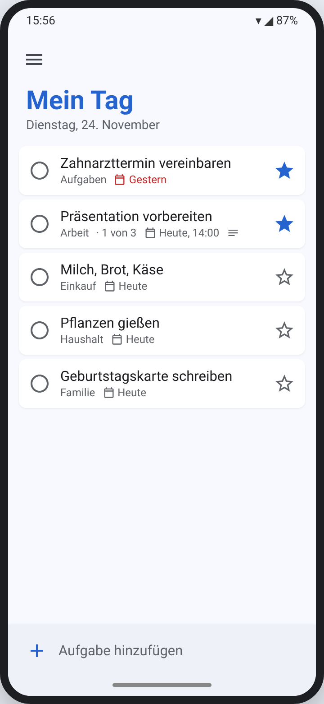
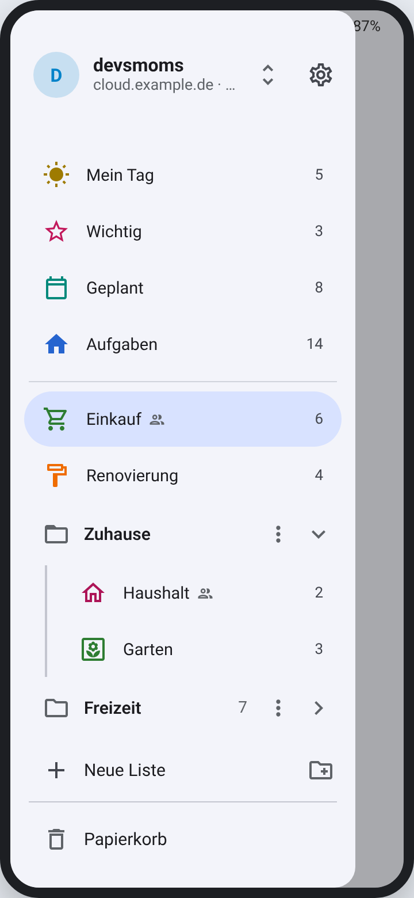
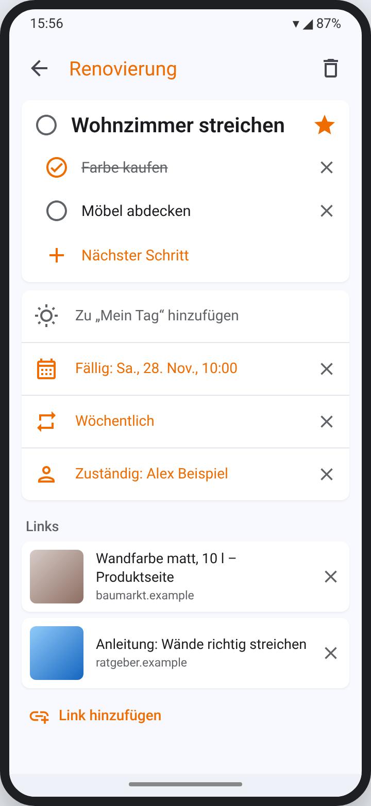
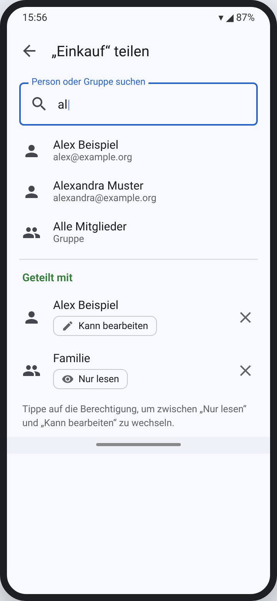
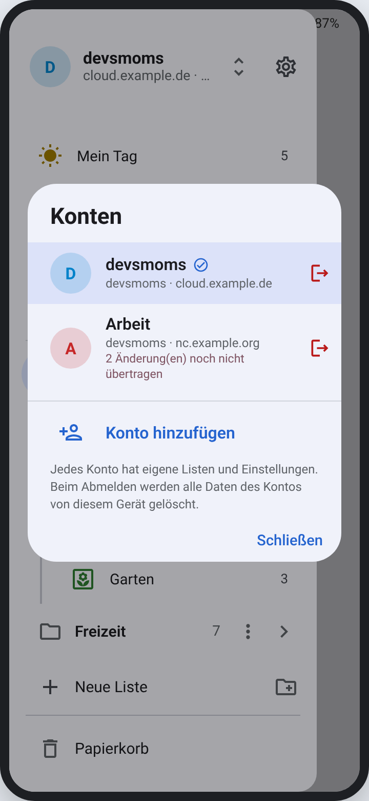
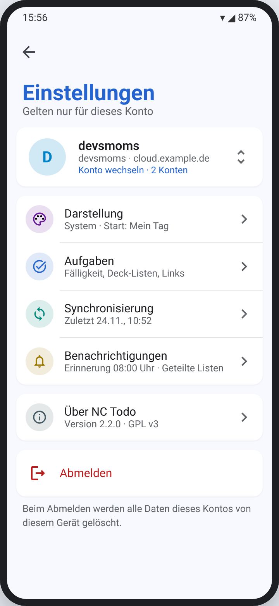
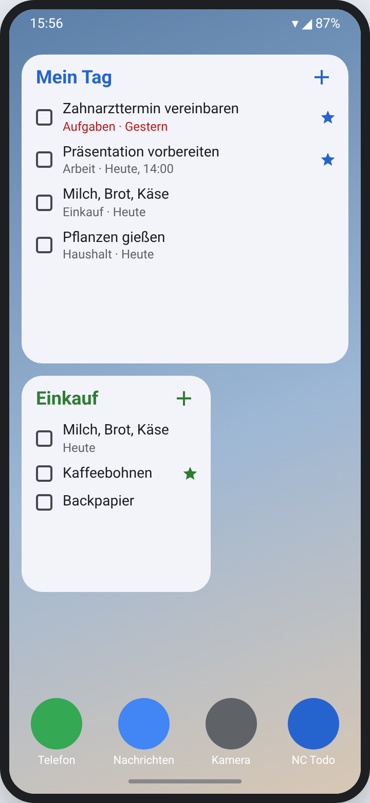

# NC Todo

Android-App für die Aufgaben deiner Nextcloud (CalDAV/VTODO) – bedient sich ähnlich wie Microsoft To Do: intelligente Listen, Schritte, „Mein Tag“, geteilte Listen, Widgets und Offline-Betrieb.

> **Beta:** Diese App wurde mit Unterstützung von KI entwickelt. Sie wird ohne Gewährleistung bereitgestellt und befindet sich im Beta-Stadium – Fehler und Abstürze sind möglich. Rückmeldungen gerne über *Issues*.

> Inoffizielle App – kein Produkt der Nextcloud GmbH und nicht mit Microsoft verbunden. „Nextcloud“ ist eine Marke der Nextcloud GmbH.

## Screenshots

<table>
  <tr>
    <td align="center"><br><sub>Mein Tag</sub></td>
    <td align="center"><br><sub>Menü mit Gruppen</sub></td>
    <td align="center"><br><sub>Aufgabe mit Schritten und Links</sub></td>
  </tr>
  <tr>
    <td align="center"><br><sub>Liste teilen</sub></td>
    <td align="center"><br><sub>Mehrere Konten</sub></td>
    <td align="center"><br><sub>Einstellungen</sub></td>
  </tr>
  <tr>
    <td align="center"><br><sub>Widgets</sub></td>
    <td></td>
    <td></td>
  </tr>
</table>

<sub>Die Bilder sind Renderings mit Beispieldaten.</sub>

## Funktionen

### Listen und Aufgaben
- Intelligente Listen: **Mein Tag** (heute fällig oder überfällig), **Wichtig** (Stern), **Geplant** (mit Fälligkeit), **Aufgaben** (alle)
- Eigene Listen anlegen, umbenennen, einfärben, löschen; optionale **Listenbeschreibung**
- **Listen-Symbole**: 29 einfarbige Icons in der Listenfarbe. Gespeichert als Emoji am Anfang des Namens (z. B. „🛒 Einkauf“) und dadurch per CalDAV synchronisiert
- **Listengruppen**: auf- und zuklappbare Gruppen im Menü. Neue Gruppe über das Ordner-Symbol neben „Neue Liste“
- **Reihenfolge per Drag & Drop**: Liste im Menü gedrückt halten und an eine andere Stelle oder in eine Gruppe ziehen; ebenso einen Gruppenkopf, um die ganze Gruppe zu verschieben; bei langen Menüs scrollt es automatisch mit. Gruppe und Position werden als eigene WebDAV-Eigenschaften gespeichert – Listennamen bleiben in Nextcloud unverändert, andere Apps ignorieren sie
- Aufgaben: abhaken, Stern, Notizen, „Zu Mein Tag hinzufügen“, **Schritte** (Unteraufgaben, kompatibel mit Nextcloud Tasks)
- **Fälligkeit mit Uhrzeit** oder ganztägig (Standard einstellbar)
- **Wiederholung**: täglich, werktags, wöchentlich, monatlich, jährlich oder „alle N Tage/Wochen/Monate/Jahre“. Beim Abhaken springt die Aufgabe auf den nächsten Termin, Schritte werden zurückgesetzt und ein erledigter Eintrag bleibt als Verlauf
- **Links**: beliebig viele pro Aufgabe, als Vorschaukarte mit Titel und Bild (abschaltbar)
- **Zuständige Person** aus der Freigabe der Liste (ohne Einladungs-Mails)
- Schnelloptionen beim Hinzufügen: **Mein Tag**, **Fälligkeit**, **Wichtig**
- Aufgaben **per Wischen löschen** (über die halbe Breite), mit „Rückgängig“
- **Papierkorb** (Nextcloud 22+): gelöschte Aufgaben und Listen wiederherstellen oder endgültig löschen
- **Deck-Listen ausblenden**: Listen von Nextcloud Deck („Deck: …“) werden standardmäßig ausgeblendet

### Teilen und Konten
- Listen mit **Nextcloud-Benutzern** teilen: **Nur lesen** oder **Kann bearbeiten**, jederzeit änderbar
- Mit dir geteilte Listen erscheinen automatisch (schreibgeschützte mit Schloss-Symbol) und lassen sich verlassen
- **Mehrere Konten**, auch auf verschiedenen Servern: Tipp auf Avatar oder Namen oben im Menü → wechseln, hinzufügen, abmelden. Jedes Konto hat eigene Listen, Offline-Daten und Einstellungen

### Startbildschirm und System
- **Widgets**: offene Aufgaben einer wählbaren Liste oder Ansicht, Abhaken direkt im Widget, „+“ zum schnellen Anlegen; bei mehreren Konten ist das Konto wählbar
- **Kachel „Neue Aufgabe“** in den Schnelleinstellungen (Menü von oben herunterwischen → Stift → Kachel hinzufügen)
- **Benachrichtigungen**: tägliche Erinnerung an fällige Aufgaben (Uhrzeit wählbar) und Änderungen anderer in geteilten Listen

### Offline und Synchronisierung
- Alle Listen und Aufgaben liegen **verschlüsselt auf dem Gerät**. Anlegen, Bearbeiten, Abhaken und Löschen geht auch ohne Netz; Änderungen werden übertragen, sobald wieder eine Verbindung besteht – auch bei geschlossener App
- Bei gleichzeitigen Änderungen werden nur die selbst geänderten Felder übertragen, Änderungen anderer bleiben erhalten
- Einstellbar: Synchronisierung beim Öffnen (immer / nach einer Pause / nie), Intervall bei geöffneter App und im Hintergrund
- Weitere Einstellungen: Design (System/Hell/Dunkel), Startbildschirm, Rückfragen beim Entfernen

## Download

Fertige, signierte APKs gibt es unter **[Releases](../../releases)**. Installation: APK auf dem Handy öffnen und „Aus dieser Quelle installieren“ erlauben.

Voraussetzungen: Android 8.0 oder neuer, Nextcloud mit gültigem HTTPS-Zertifikat (z. B. Let's Encrypt).

**Tipp:** In Nextcloud unter *Einstellungen → Sicherheit → Geräte & Sitzungen* ein eigenes App-Passwort für NC Todo erstellen. Es lässt sich jederzeit widerrufen und ist bei Zwei-Faktor-Anmeldung ohnehin nötig.

## Sicherheit

- **Zugangsdaten** werden mit AES-256-GCM verschlüsselt, mit einem eigenen Schlüssel pro Konto. Der Schlüssel liegt im Android Keystore (Hardware/StrongBox, falls vorhanden) und kann weder ausgelesen noch exportiert werden.
- Der **Offline-Speicher** ist ebenfalls AES-256-GCM-verschlüsselt (eigener Keystore-Schlüssel) und liegt im privaten App-Speicher.
- **Kein Backup**: `allowBackup=false` und Data-Extraction-Rules verhindern, dass Daten per Cloud-Backup oder Geräteumzug das Gerät verlassen.
- **Nur HTTPS** (TLS 1.2+), keine Klartext-Verbindungen, nur System-Zertifizierungsstellen.
- Das Passwort wird **nur an den angemeldeten Server** geschickt; Verweise auf fremde Adressen werden abgelehnt. Link-Vorschauen laufen über einen eigenen Client ohne Zugangsdaten.
- XML wird gegen XXE/Entity-Angriffe gehärtet geparst, Eingaben in XML und iCalendar werden escaped.
- Bearbeitungen nutzen ETags (`If-Match`), damit Änderungen anderer nicht überschrieben werden. Unbekannte iCalendar-Daten anderer Apps bleiben erhalten.
- Login-Bildschirm ist vor Screenshots geschützt (`FLAG_SECURE`), nichts wird geloggt.
- Benachrichtigungen zeigen auf dem Sperrbildschirm nur die Anzahl, keine Titel. Die Schnelleinstellungs-Kachel verlangt bei gesperrtem Gerät zuerst das Entsperren. Hinweis: Widgets zeigen Aufgabentitel auf dem Startbildschirm.
- **Abmelden** löscht alles, was zu diesem Konto auf dem Gerät gespeichert ist: Zugangsdaten, Schlüssel, Offline-Daten (auch noch nicht übertragene Änderungen), Einstellungen, Hintergrundjobs und Benachrichtigungen.

## Grenzen

- Listen anlegen, umbenennen, teilen, löschen sowie Gruppen und Reihenfolge ändern geht nur online.
- Leere Gruppen gibt es nur auf dem Gerät, auf dem sie angelegt wurden, bis die erste Liste hineingezogen wird.
- Hintergrund-Synchronisierung: Android erlaubt höchstens alle 15 Minuten, der genaue Zeitpunkt kann sich zum Akkusparen verschieben. Nextcloud bietet für CalDAV kein Push, Benachrichtigungen über Änderungen anderer kommen deshalb nicht in Echtzeit.
- Erinnerungen (VALARM) einzelner Aufgaben werden nicht angezeigt, bleiben aber erhalten; es gibt die tägliche Sammel-Erinnerung.
- Teilen funktioniert mit Nextcloud (oc:share-Erweiterung), nicht mit beliebigen CalDAV-Servern. Die Benutzersuche beachtet die Freigabe-Einstellungen des Servers.

## Selbst bauen

1. Projekt in Android Studio öffnen (*File → Open*), Gradle-Sync abwarten. Bei der Frage nach dem Gradle-JDK „Embedded JDK“ wählen.
2. Direkt auf dem Handy starten (▶) oder *Build → Generate Signed App Bundle / APK → APK*.
3. Unit-Tests unter `app/src/test/…` (Parser/Protokoll, Offline-Sync mit simuliertem Server, Konten-Speicher, Listengruppen): Rechtsklick → *Run*.

### Aufbau

```
app/src/main/java/de/devsmoms/nctodo/
  ical/      iCalendar-Parser/Serializer, VTODO-Mapping, Wiederholungen
  dav/       WebDAV/CalDAV-XML, HTTP-Client, Principal-Helfer
  data/      CalDAV-Zugriff, Modelle, Konten, verschlüsselte Zugangsdaten und Offline-Speicher, Einstellungen
  sync/      Offline-Sync-Engine (Warteschlange, Konfliktauflösung), WorkManager-Jobs, Benachrichtigungen
  ui/        Compose-Oberfläche (Listen, Details, Teilen, Konten, Einstellungen, Papierkorb)
  widget/    Startbildschirm-Widget (Glance)
  quickadd/  Schnell-Anlegen und Schnelleinstellungs-Kachel
```

### Release veröffentlichen (für Maintainer)

1. In `app/build.gradle.kts` `versionCode` (+1) und `versionName` erhöhen, committen.
2. Tag setzen und pushen, z. B. `git tag -a v2.2.0 -m "Version 2.2.0"` und `git push origin v2.2.0`.
3. Die GitHub Action „Release APK“ baut die signierte APK und hängt sie an das Release.

Benötigte Repository-Secrets (*Settings → Secrets and variables → Actions*):
`SIGNING_KEYSTORE_BASE64`, `SIGNING_STORE_PASSWORD`, `SIGNING_KEY_ALIAS`, `SIGNING_KEY_PASSWORD`.

## Lizenz

Copyright (C) 2026 devSmoms

Dieses Programm ist freie Software: Sie können es unter den Bedingungen der GNU General Public License, wie von der Free Software Foundation veröffentlicht, weitergeben und/oder modifizieren, entweder gemäß Version 3 der Lizenz oder (nach Ihrer Wahl) jeder späteren Version.

Die Veröffentlichung dieses Programms erfolgt in der Hoffnung, dass es Ihnen von Nutzen sein wird, aber OHNE IRGENDEINE GARANTIE, sogar ohne die implizite Garantie der MARKTREIFE oder der VERWENDBARKEIT FÜR EINEN BESTIMMTEN ZWECK. Details finden Sie in der GNU General Public License.

Den vollständigen Lizenztext finden Sie in der Datei [LICENSE](LICENSE).

Die verwendeten Bibliotheken stehen unter Apache-2.0 bzw. BSD-3-Clause (Protocol Buffers in DataStore); beide sind mit der GPL v3 vereinbar. Details: [THIRD_PARTY_NOTICES.md](THIRD_PARTY_NOTICES.md).
